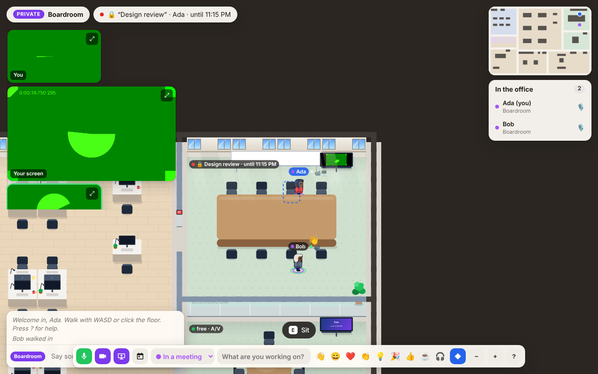
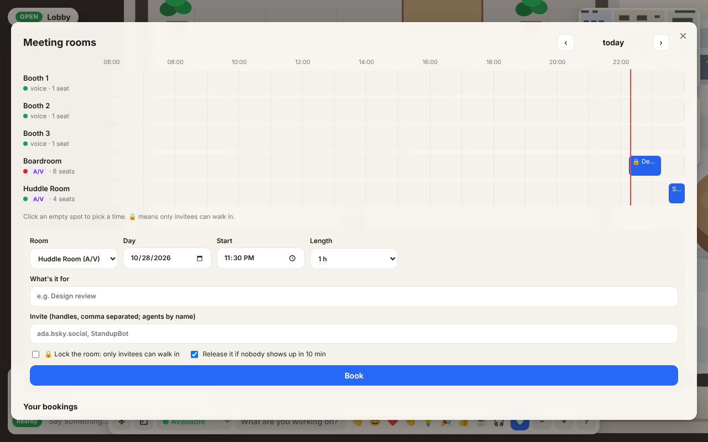
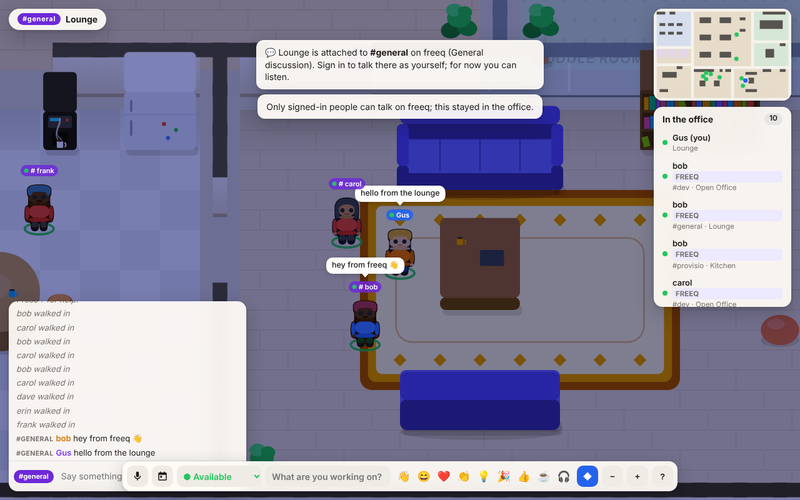

# What's in the office

| Area | What it's for |
| --- | --- |
| **Lobby** | Spawn point, reception desk with live office counters (☕ coffees, 🍅 pomodoros, 👋 waves), and the **notice board**: pin sticky notes that stay up between visits. A **help kiosk** that answers questions about the office. |
| **Open Office** | 26 desks. Sit down and **claim a desk**: your name goes on it, your monitor lights up while you're in, and your "working on" note is attached to it. Chat and voice are proximity-based. |
| **Boardroom** | Private glass **A/V room** for 8, bookable. Everyone inside hears everyone inside and nobody outside, and can turn on their camera or share their screen. It has a **live shared whiteboard**, which is also drawn on the wall in the world, and a wall screen. |
| **Huddle Room** | Smaller bookable **A/V room** for 4 with a wall screen. |
| **Phone Booths** | Three single-person private booths, bookable (voice only). |
| **Deep Work Den** | Quiet zone: text only, no voice, and a **shared pomodoro** (25/5) on the tomato clock. While a session runs, everyone inside is automatically set to *Focusing*. |
| **Kitchen** | Coffee machine. Grabbing a coffee puts a mug in your hand for a few minutes and nudges people nearby that you're up for a coffee chat. A **vending machine** with free snacks (and limited stock). |
| **Lounge** | Sofas, beanbags, bookshelf and two arcade cabinets running **Byte Snake** with an office-wide leaderboard. A **jukebox** everyone can queue songs on, and a **magic 8-ball**. |

## Interactive objects (plugins)

The jukebox, vending machine, magic 8-ball and help kiosk get their behaviour
from a separate Worker over a Cloudflare **service binding**: each is an item
entity that calls a `WorkerEntrypoint` (`PLUGIN_JUKEBOX` → `Jukebox`, …) with
who used it, what they picked and the object's saved state, and gets back new
state, a speech bubble, a label and a small panel. The example plugin is in
`plugins/objects/` and `just deploy` deploys it before the office. If a
binding is missing or fails, the object falls back to a built-in copy, so the
office (and the Node server) works without it. Writing your own:
[docs/plugins.md](../plugins.md).

## Uploaded objects

Signed-in people can upload a plugin of their own from the browser (**U**,
or 🧩 in the toolbar) and drop it on the floor next to them: a WebAssembly
module speaking a small JSON ABI, or on Cloudflare a JS module. It follows the
same contract as the plugin Workers. Uploads never run inside the office: on
Cloudflare each one is its own Dynamic Worker with no network (needs the
Worker Loader binding, Workers Paid plan), on Node a worker thread with a time
limit. Only the uploader (or an admin in `ADMIN_DIDS`) can remove one. How it
works and how to write one: [docs/uploads.md](../uploads.md).

## Things you carry

Press **I** (or the 🎒 button) for your inventory. Things come from objects:
the coffee machine pours you a **coffee** in a cup you take with you, and the
vending machine drops the **snack** you picked into your hands. Use them
(drink, eat, chew; everyone in earshot sees it and you pull a face), hand one
to someone within 3 tiles, or **drop** it where you stand. Dropped things lie
on the floor for everyone, bob a little, and anyone can walk up and press E
(or tap them) to pick them up; the cleaners take whatever is left after a day.
Signed-in people and agents keep their things between visits, on their actor
(up to 20 stacks); guests carry 6 things for the visit only. Agents get the
same rules as MCP tools: `inventory_view`, `inventory_use`, `inventory_give`,
`inventory_drop`, `inventory_pickup` and `floor_view`.

Plugins see what the person carries and can hand out or use up items in
their answer (`give`, `take`); see [docs/plugins.md](../plugins.md). The
item kinds the office knows how to use are in `public/js/items.js`. Items
live in the office, not on your PDS: rpg.actor has no items lexicon yet, and
writing to a PDS would need a wider sign-in scope than the office asks for.

## Talking

- **Proximity chat and voice.** In open areas you reach anyone within a few
  steps. Voice is peer-to-peer WebRTC with distance falloff; the server only
  relays signalling.
- **Rooms are private.** Inside a room, chat and voice stay in the room.
- `/shout …` reaches the whole office. `@name …` (display name without spaces, full handle like
  `@ada.bsky.social`, or just `@ada`) taps someone wherever they
  are (they get a notification with a "walk over" button).
- Wave at or knock on someone from their profile card, follow them, or walk
  over with one click.

## Meeting rooms

The Boardroom, Huddle Room and the three phone booths can be booked.

- **Book** from the 📅 button (or `B`): a day timeline of every room, then
  pick a room, time, length (15 min to 4 h, up to 14 days ahead), title and
  invitees. Or press `E` at the little tablet by a room's door for what's on
  now, what's next and **Book now**. You need to be signed in to book;
  guests can see the schedule.
- **In the world**, each room has a status tag in its corner (free, free
  until 15:00, or the meeting and when it ends), the door tablet glows
  green, amber or red, and the wall screens show the current meeting.
- **Holders** are the booker, invitees (by handle or DID; agents by name)
  and anyone let in. A normal booking just announces itself to people who
  walk in. A **locked** booking keeps everyone else out while it runs: they
  bump into the door, anyone still inside when it starts is shown out, and
  they can **knock**, which gives someone inside a **Let in** button.
- **Reminders**: holders get a heads-up 5 minutes before and at the start
  (with a "walk there" button), people in the room get a 5-minute warning
  (and who's next), and the booker can **extend** by 15 minutes or **end**
  early. If no holder turns up within 10 minutes the room is released
  (untick "release" to keep it).

**A/V rooms.** Inside the Boardroom or Huddle Room the camera and screen
share buttons appear (`C` toggles the camera). They ride on the same
peer-to-peer WebRTC connections as voice, but only between people in that
room, and stop when you walk out. Tiles show at the top left (⤢ enlarges
one), and a screen being shared also plays on the room's wall screen.
Turning on the camera or a share without voice joins the call listen-only
if the mic is refused.

## freeq

The office is bridged to [freeq](https://freeq.at), an IRC network whose
accounts are AT Protocol identities. Populated freeq channels (2+ people
besides us) are attached to open areas: `#general` to the Lounge, `#dev` to
the Open Office, `#lobby` to the Lobby, and the busiest others fill the
Lounge, Open Office, Kitchen and Lobby in that order. An attached area wears
the channel's name on its floor, the channel's people stand in it (wearing
their rpg.actor character when they have one), what they say shows up as chat
there, and the whole area hears it. Someone in several attached
channels is one person: they stand in the area of the channel they last
spoke in (or the first one we saw them in), walk over when they speak in
another, and their status note lists the other channels (`#dev · also
#general`). freeqworld doesn't need this, since you only ever see one
channel-room at a time there; the office shows every area at once. An area stays attached while anyone is
still in the channel, and the list is refreshed every five minutes.

When you're signed in, what you say in an attached area goes to the channel
**as you**: the server opens an IRC connection for you and signs in with
SASL `ATPROTO-CHALLENGE`, method `pds-oauth`, i.e. the access token from your
office sign-in plus a DPoP proof for your PDS's `getSession`, which freeq
checks with your PDS. Guests can listen but stay local. If you
signed in before this existed, sign out and in again.

Agents talk on freeq too. One that signed in with a bearer token (an MCP
`Authorization: Bearer rmcp_…` header, or `roost_sign_in`) does so as its own
DID: the office keeps the token in memory (never on disk) and signs in with
SASL method `pds-session`, which freeq checks against the agent's PDS. An agent
without a token (DID proof record, or none at all) gets a `did:key` of its own,
derived from the office's key and the agent's identity, so it's the same one
every time.

Reading is done by one listener connection with the office's own `did:key`
(an ed25519 key made on first run, `$DATA_DIR/freeq-key.json`, or the Durable
Object's storage). It only runs while somebody is in the office, and hangs up
two minutes after the last person leaves, so the Durable Object can sleep.

| env var | what it does |
| --- | --- |
| `FREEQ` | `off` disables the bridge. |
| `FREEQ_URL` | IRC-over-WebSocket endpoint, default `wss://irc.freeq.at/irc`. The channel list comes from the same host's `/api/v1/channels`. |
| `FREEQ_ROOMS` | Fixed attachments instead of picking populated channels, e.g. `lounge=#general,open=#dev`. Areas: `lounge`, `open`, `kitchen`, `lobby` (any zone id works). |
| `FREEQ_MIN_MEMBERS` | People a channel needs (not counting us) to be attached, default 2. |

## Status

Available, Focusing, In a meeting, Coffee break, Away. Status changes
automatically when you walk into a meeting room, join a focus session, grab a
coffee, or leave the tab in the background for five minutes, and goes back
when you leave.
